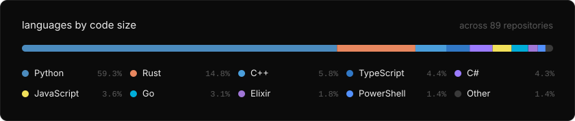

<h1 align="center">Hi, I'm superbodik</h1>

<b>Game & Engine Developer • Windows Tooling • Rust / Python / C++</b>

  

  
  
  
  

---

## Connect with me

  
  
  

---

## Featured projects

  
  

  
  

  
  

---

## Tech Stack

  

  
  
  
  
  
  
  
  

---

## Projects

- **[slahManager](https://github.com/superbodik/slahManager)** — Windows 11 optimizer for gamers, C# + WPF
- **[EIDOS Engine](https://github.com/superbodik/projectEIDOS)** — voxel evolution sandbox engine in pure C++: from the Stone Age to space
- **[crc-code](https://github.com/superbodik/crc-code)** — GPU-native code editor: Rust core, tree-sitter, wgpu renderer, no web view
- **[NeiRo-life](https://github.com/superbodik/NeiRo-life)** — open world where creatures evolve with neural networks (Python, Pygame)
- **[CS2-Boost](https://github.com/superbodik/CS2-Boost)** — latency and FPS toolkit for Counter-Strike 2, with mineDres-Team
- **[Vaultspace](https://github.com/superbodik/Vaultspace)** — virtual data room: NestJS, Prisma, Postgres, React

---

## GitHub Analytics

  

  

## Contribution Graph

  

---

## Random Dev Quote

  

